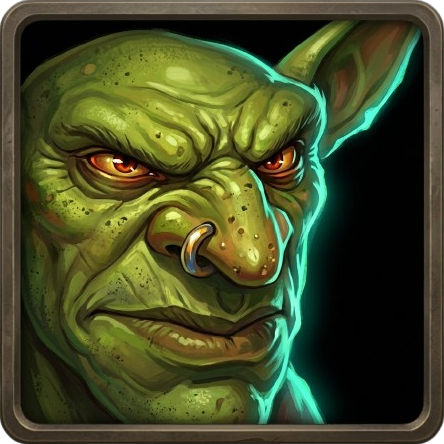
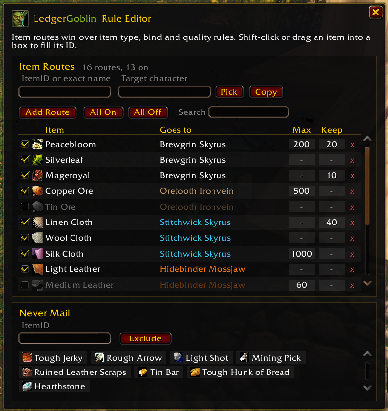
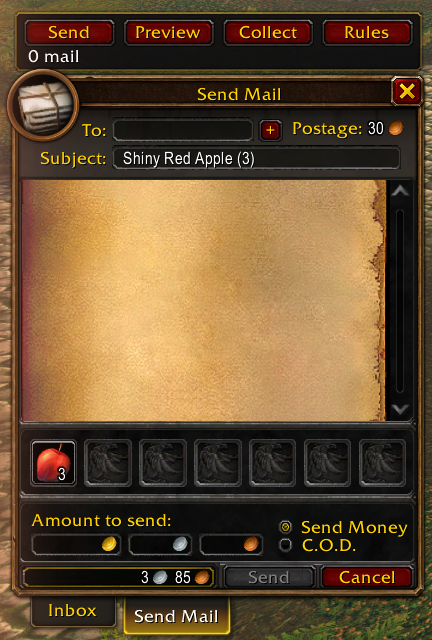
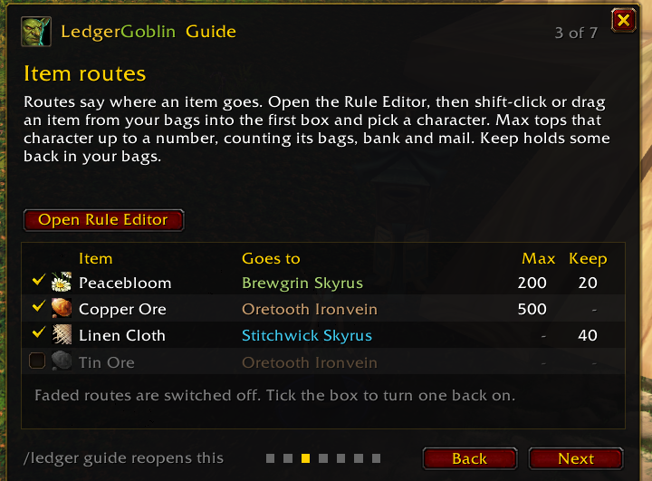
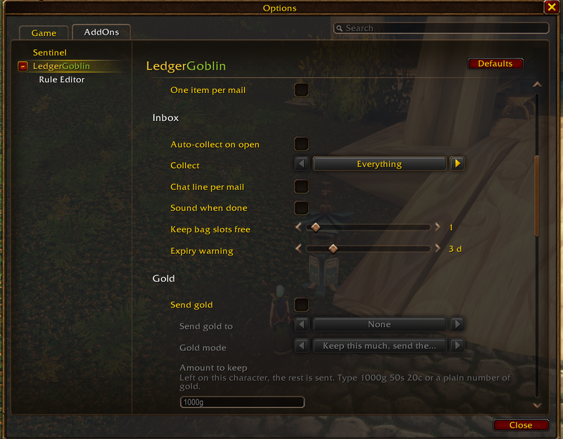

<div align="center">



# LedgerGoblin

**Mails gold and items to your alts by rule, collects your inbox by filter, and keeps a ledger of what moved.**

[](https://github.com/Kkthnx-Wow/LedgerGoblin/commits/main)
[](https://github.com/Kkthnx-Wow/LedgerGoblin/issues)
[](https://www.curseforge.com/wow/addons/ledgergoblin)
[](LICENSE)

</div>

---

## Overview

Set up where things go once, open a mailbox, and press Send. LedgerGoblin works out what each alt should get, packs it into mails, and sends them one at a time. Press Collect and it empties your inbox the same careful way, recording where the gold came from.

Mail can't be undone, so nothing is sent until you set up a rule and press Send or turn on auto-send. Soulbound and quest items are never routed, unknown names are refused, and big sends can ask first.

Runs on **Retail** (Midnight) and **WoW Forever**.

<p align="center">
  
  
</p>

---

## Installation

- **CurseForge.** [LedgerGoblin on CurseForge](https://www.curseforge.com/wow/addons/ledgergoblin), or search for it in your addon manager.
- **Manual.** Download a release from the [Releases](https://github.com/Kkthnx-Wow/LedgerGoblin/releases) page and put the `LedgerGoblin` folder in `Interface\AddOns` for your client.

A short guide opens the first time you log in, and `/ledger guide` brings it back.

<p align="center">
  
</p>

Log in once on each alt so LedgerGoblin knows it exists. On Forever characters are named "First Surname", on Retail "Name-Realm". Only characters it has seen (or ones you add by hand from another account) can receive mail.

---

## Sending

Every item in your bags goes through one list and stops at the first match.

1. **Never Mail.** Items on this list are skipped.
2. **Item routes.** An exact item to a character. A route can **keep** some in your bags and can **restock** up to a max, counting what the target already holds in bags, bank, inbox and mail on the way.
3. **Item types.** Whole types, for example every herb to your alchemist. Trade goods are split by subtype.
4. **Bind.** Bind on Equip gear still in your bags, and warband bound items.
5. **Quality.** A catch-all by quality.

<p align="center">
  
</p>

**Gold** can keep a set amount and send the rest, send a fixed amount, or send a percentage. It always leaves postage and a repair reserve behind.

Postage is planned at 30 copper per attachment and checked against the real mail price before each send. The queue sends one mail at a time and only moves on once the server confirms it.

On the Send Mail tab, **alt-click** a bag item to attach every stack of it, and use the **+** beside the To box to pick one of your characters or a recent name.

## Collecting

**Collect** takes mail by filter.

| Filter | Takes |
| --- | --- |
| Everything | All mail except COD, GM letters and pending sales |
| Gold only | Gold, leaves items in the mail |
| Items only | Items, leaves gold in the mail |
| Auction mail | Sales, purchases, expired and cancelled auctions, refunds |
| From my alts | Mail from your own characters |

It stops taking items when your bags reach the free slot floor you set, leaves gold that would pass the gold cap, and refreshes the inbox when more than 50 mails wait on the server. Right-click Collect to run a different filter once. Turn on chat lines to see each sale, purchase, refund and gift as it comes in.

## Ledger

- Gold collected from mail is recorded by source per character per day. `/ledger income`
- Every inbox scan saves what waits on that character and when it expires. At login you are warned about mail that expires soon. `/ledger alts`
- Auction sales and purchases are kept with item, count, price and the other player. `/ledger sales`
- Sends are logged with gold, item counts and postage. `/ledger log`, `/ledger stats`

---

## Commands

| Command | Does |
| --- | --- |
| `/ledger` or `/lg` | Open settings |
| `/ledger guide` | A page by page tour of the addon |
| `/ledger send` | Send by rules now |
| `/ledger preview` | List what would be sent |
| `/ledger collect [all\|gold\|items\|auction\|alts]` | Take inbox mail |
| `/ledger rules` | Open the Rule Editor |
| `/ledger rule add <itemID\|name> <Name-Realm> [max]` | Add an item route |
| `/ledger rule list`, `remove [n]`, `toggle <n>` | Manage item routes |
| `/ledger keep <itemID> [n]` | Keep n in bags, send the rest |
| `/ledger exclude <itemID>`, `exclude remove <itemID>` | Never mail an item |
| `/ledger alts` | Gold and mail on every character |
| `/ledger income [days]` | Mail income by source |
| `/ledger sales [days]` | Auction sales and purchases |
| `/ledger log`, `stats`, `reset` | History |
| `/ledger alt add\|remove\|list\|export\|import` | Characters on another account |
| `/ledger toggle` | Auto-send on this character |
| `/ledger minimap`, `trace` | Minimap button, send tracing |
| `/ledger demo`, `demo off` | Preview the Rule Editor with sample routes |

The minimap button and the AddOn Compartment open settings on left-click and the Rule Editor on right-click.

---

## Development

Headless tests run the addon files against a small fake client.

```
lua5.1 tools/headless/run.lua LedgerGoblin
```

Releases are built by the BigWigs packager in GitHub Actions. Pushing a tag such as `2.0.0` tests, packages and uploads one file to CurseForge tagged for both Retail and Forever, since the TOC lists both interfaces. Running the Release workflow by hand is a dry run that only builds the zip.

---

## Support

- **PayPal** [paypal.me/KkthnxTV](https://www.paypal.me/KkthnxTV)
- **Patreon** [patreon.com/Kkthnx](https://www.patreon.com/Kkthnx)
- **Battle.net / Balance** `Kkthnx#1105` or `JRussell20@gmail.com`
- **In-game gold** Kkthnx on Area 52 (US)

## License

Released under the **MIT License**. See [LICENSE](LICENSE).

Developed by **Josh "Kkthnx" Russell**.
